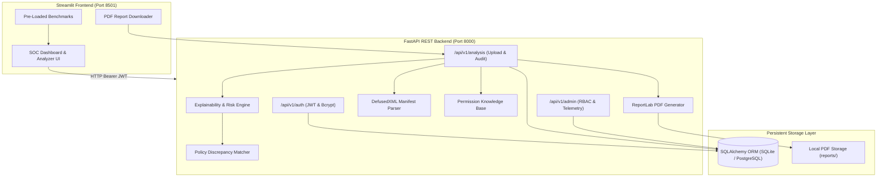

# 🛡️ Explainable Application Privacy and Permission Analyzer
**Problem Statement: Cybersecurity / Application Privacy / Explainable Security — PS02**

An enterprise-grade, explainable security auditing platform that analyzes Android application permissions, parses `AndroidManifest.xml` files using safe XML parsers, and cross-examines permission requests against declared privacy policies to detect covert tracking, spyware combinations, and privacy discrepancies.

---

## 🌟 Key Capabilities & Modules

1. **DefusedXML Manifest Parser**:
   - Safely parses `AndroidManifest.xml` files resisting Billion Laughs, quadratic blowup, and external entity (XXE) attacks using `defusedxml`.
   - Extracts permissions (`uses-permission`, `permission`), components (`activity`, `service`, `receiver`, `provider`), exported flags, and target SDK security postures.

2. **Android Permission Knowledge Base**:
   - Curated JSON knowledge base mapping Android permissions to protection levels (dangerous, normal, signature, special), privacy threats, real-world abuse scenarios (malware, stalkerware, banking trojans), severity scores (0-10), and developer remediation advice.

3. **Multi-Permission Correlation / Attack Chain Engine**:
   - Identifies dangerous permission clusters that form dangerous surveillance or fraud capabilities:
     - *Audiovisual Surveillance Chain:* `CAMERA` + `RECORD_AUDIO` + `INTERNET`
     - *24/7 Geolocation Tracking Chain:* `ACCESS_FINE_LOCATION` + `ACCESS_BACKGROUND_LOCATION` + `INTERNET`
     - *Financial 2FA Interception Chain:* `READ_SMS` / `RECEIVE_SMS` + `INTERNET`
     - *Social Graph Scraping:* `READ_CONTACTS` + `READ_CALL_LOG` + `INTERNET`
     - *Overlay Phishing & Tapjacking:* `SYSTEM_ALERT_WINDOW` + `INTERNET`

4. **Purpose & Privacy Policy Discrepancy Engine**:
   - Analyzes privacy policy disclosures against requested permissions.
   - Flags **CRITICAL CONTRADICTIONS**: e.g. App policy explicitly asserts *"We do NOT collect location or SMS"*, but the manifest requests `ACCESS_FINE_LOCATION` or `READ_SMS`.
   - Flags **UNDISCLOSED SENSITIVE PERMISSIONS**: Sensitive permissions requested without corresponding privacy disclosures.

5. **Explainable Risk Scoring**:
   - Transparent mathematical score from 0 to 100 with categorical ratings (`LOW`, `MEDIUM`, `HIGH`, `CRITICAL`), broken down into base permission weights, combination penalties, exported component exposure, and policy discrepancies.

6. **Automated PDF Report Generation**:
   - Generates official PDF audit certificates using `reportlab`, containing executive summaries, risk gauges, multi-permission threat scenarios, policy discrepancy tables, and developer remediation checklists.

7. **Security & Authentication (RBAC) & Sessions**:
   - Real persistent database authentication using SQLAlchemy (SQLite development database, PostgreSQL-compatible architecture).
   - Password hashing using `bcrypt` (with standard salt rounds).
   - Cryptographically signed JWT bearer tokens (`pyjwt`).
   - Active session tracking in `user_sessions` table.
   - Dedicated Analyst Profile page with live session inspection and password rotation.
   - Role-Based Access Control (`user` vs `admin`).
   - Immutable security audit logging for compliance.

8. **Admin Management & Platform Telemetry**:
   - System-wide statistics on analyzed applications, risk distribution, top dangerous permissions across the ecosystem, user account activation/deactivation, role promotion, and security event logs.

9. **Normalized 8-Table Database Architecture with Alembic Migrations**:
   - `users`: User identity, hashed passwords, roles, status
   - `user_sessions`: Active JWT sessions, IP addresses, client user-agents, expirations
   - `analyses`: Application manifest audit metadata, risk score, package name
   - `permissions`: Granular permission protection levels, abuse scenarios, severity scores
   - `policy_excerpts`: Text snippets and stances extracted from privacy policies
   - `comparison_findings`: Correlated threat chains and discrepancy findings
   - `reports`: Saved PDF audit reports, paths, and metadata
   - `audit_logs`: Immutable compliance trail of user and admin actions

---

## 🏛️ System Architecture



---

## ⚙️ Tech Stack

- **Language:** Python 3.10+ / 3.15
- **Backend:** FastAPI, Starlette, Uvicorn
- **Frontend:** Streamlit
- **Database & ORM:** SQLAlchemy (SQLite for local dev, PostgreSQL ready)
- **Safe XML Parser:** `defusedxml`
- **Security & Cryptography:** `bcrypt`, `pyjwt`
- **PDF Generation:** `reportlab`
- **Validation:** Pydantic V2
- **Testing:** Pytest

---

## 🚀 Quick Start Guide

### 1. Install Dependencies
```bash
pip install -r requirements.txt
```

### 2. Configure Environment
Copy `.env.example` to `.env`:
```bash
cp .env.example .env
```

### 3. Run Both Backend & Frontend
Launch both services simultaneously using the runner:
```bash
python run.py
```
Or start them individually:
```bash
# Terminal 1: FastAPI Backend (Port 8000)
python run_backend.py

# Terminal 2: Streamlit Frontend (Port 8501)
python run_frontend.py
```

- **Frontend Portal:** [http://localhost:8501](http://localhost:8501)
- **Backend OpenAPI Docs:** [http://127.0.0.1:8000/docs](http://127.0.0.1:8000/docs)

---

## 🔑 Default Evaluator Credentials

| Role | Username / Email | Password |
| :--- | :--- | :--- |
| **Administrator** | `admin@privacyanalyzer.local` or `admin` | `AdminSecurePassword123!` |
| **New Analyst** | Register via Frontend *"Create Analyst Account"* tab | *(Self-chosen)* |

---

## 🧪 Pre-Loaded Security Benchmarks

The application includes 3 ready-to-test real-world security benchmarks in `data/sample_manifests/`:

1. **Super Bright Flashlight (Spyware / High-Risk Stalkerware)**
   - Manifest requests `CAMERA`, `RECORD_AUDIO`, `ACCESS_FINE_LOCATION`, `ACCESS_BACKGROUND_LOCATION`, `READ_SMS`, `READ_CONTACTS`.
   - Policy explicitly claims: *"We do not collect location or SMS data."*
   - **Result:** Critical Risk (>85/100), Surveillance Combo Alert, 2FA SMS Interception Alert, Critical Policy Contradiction.

2. **Apex Vault Mobile Banking (Legitimate Fintech)**
   - Manifest requests `CAMERA` (for check deposit) and `ACCESS_COARSE_LOCATION` (for ATMs).
   - Policy transparently justifies each data use case.
   - **Result:** Low Risk (<25/100), Zero Contradictions.

3. **Smart Calculator (Minimal Benign Utility)**
   - Manifest requests only `VIBRATE` and `INTERNET`.
   - **Result:** Low Risk (<15/100), Clean Baseline.

---

## 🧪 Running Automated Tests

Run the complete test suite with 100% pass verification:
```bash
python -m pytest -v
```
All 12 unit and integration tests verify manifest parsing, XML bomb rejection, explainability calculations, policy contradiction matching, JWT authentication, and PDF report creation.

